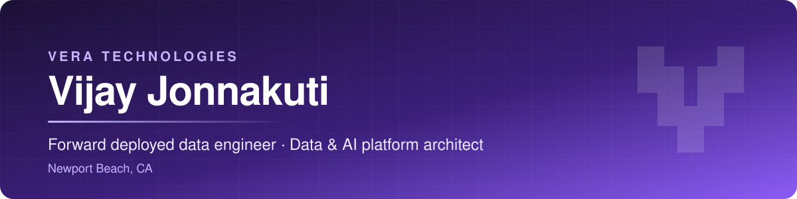

  

  
  

  <b>20 years</b> of building data platforms inside the customer's business, <b>13</b> of them embedded with a global asset
  manager's risk and analytics teams. 
  VERA Technologies is my digital product and AI studio, where I design, build and ship products end to end.

> Most of the work here is in private repositories. The contribution graph on this profile is real activity; this page
> says what it is.

 

## What I'm building

<table>
<tr>
<td width="50%" valign="top">
<h3>social-ops</h3>

A command-line tool that publishes one piece of media to 9 social platforms (Facebook, Instagram, Threads, TikTok, YouTube, LinkedIn, X, Pinterest, Bluesky) and collects the stats afterwards. Talks to each platform's REST API directly, with no vendor SDKs.

    

</td>
<td width="50%" valign="top">
<h3><a href="https://www.offersnear.me">offersnear.me</a></h3>

A location-aware deals platform with privacy-preserving geolocation and a pipeline that pulls from 15+ deal vendors.

   

</td>
</tr>
<tr>
<td width="50%" valign="top">
<h3><a href="https://www.kudo.kids">kudo.kids</a></h3>

A cross-platform mobile and web app, live on the App Store, designed, built and shipped end to end on a serverless backend.

   

</td>
<td width="50%" valign="top">
<h3><a href="https://www.veratech.dev">veratech.dev</a></h3>

The studio's website.

</td>
</tr>
</table>

More projects and case studies: <a href="https://www.veratech.dev"><b>www.veratech.dev</b></a>

## Commit activity

  
  
  
  

As of November 12, 2026

| | |
| :-- | :-- |
| **Commits across private repositories since August 2026** | 480+ |
| **Private repositories with active work** | 4 (three above, one client project) |
| **social-ops** | 168 commits, 840+ offline unit tests, about 28,500 lines of Python, CI on every push |
| **offersnear.me** | 152 commits, 28 pull requests |

## How I build

<table>
<tr>
<td width="50%" valign="top">
<h4>Fail closed</h4>
Anything that cannot be verified does not ship. social-ops records a pending row before any call that can create a post, so a crash never produces a duplicate.
</td>
<td width="50%" valign="top">
<h4>Configuration over code</h4>
A new client, pipeline or platform should be a config file, not a project.
</td>
</tr>
<tr>
<td width="50%" valign="top">
<h4>Tests gate everything</h4>
Including AI-written code.
</td>
<td width="50%" valign="top">
<h4>Cloud native by default</h4>
All new development is built cloud native, and serverless where it fits, so nothing runs when nobody is using it.
</td>
</tr>
</table>

## Work with me

  Code walkthroughs of the private repositories are available on request.

  
  

